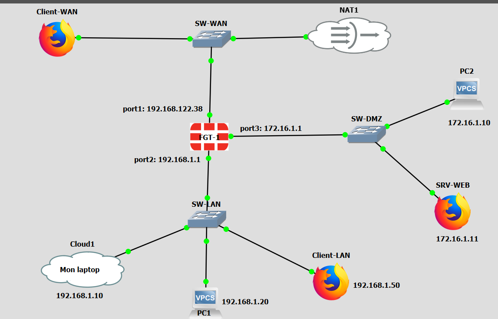

# FortiGate — fondamentaux (politiques, DMZ, VIP)

Transposition sur FortiGate des labs pfSense 01 à 03, dans le budget de la licence d'essai (3 politiques).

📄 Fiche complète : [docs/Lab_Securite_FortiGate_Fondamentaux.pdf](docs/Lab_Securite_FortiGate_Fondamentaux.pdf) · ⚙️ Configuration : [configs/fortigate-fondamentaux.txt](configs/fortigate-fondamentaux.txt)



## Interfaces

| Interface | GNS3 | Rôle | Adressage | Accès admin |
|-----------|------|------|-----------|-------------|
| port1 | Ethernet0 | WAN | DHCP 192.168.122.x | ping http https ssh |
| port2 | Ethernet1 | LAN | 192.168.1.1/24 | ping http https ssh |
| port3 | Ethernet2 | DMZ | 172.16.1.1/24 | **ping uniquement** |

## Politiques (3/3)

| # | Nom | Flux | Service | NAT | Équivalent pfSense |
|---|-----|------|---------|-----|--------------------|
| 1 | LAN-to-WAN | port2 → port1 | ALL | Oui | Règle allow LAN + NAT sortante automatique |
| 2 | DMZ-to-WAN | port3 → port1 | `web_ports` (HTTP, HTTPS, DNS) | Oui | Alias `web_ports` |
| 3 | WAN-to-DMZ-Web | port1 → port3 | HTTP, destination **VIP** | Non | Port forward WAN:80 → .11:80 |
| 0 | Implicit Deny | tout le reste | — | — | Default deny |

## Tests validés
- Implicit deny observé (journalisation des violations activée), puis LAN → Internet autorisé.
- Stateful : les réponses reviennent grâce à la session (`orgin`/`reply`, `act=snat`), sans politique inverse.
- DMZ : HTTPS et DNS sortants OK, ICMP et DMZ → LAN bloqués.
- VIP : « DMZ server OK » depuis un client WAN, `act=dnat` dans la session.

## Pièges
- Vue de logs vide : un filtre « Policy ID: 0 » resté actif.
- Logs Accept écrits **en fin de session** (environ 60 s pour un ping).
- socat : placer la réponse HTTP dans un fichier (les `\r\n` passés directement cassent la commande).

## Aide-mémoire
```
diagnose debug flow filter addr 8.8.8.8
diagnose debug flow show function-name enable
diagnose debug flow trace start 10
diagnose debug enable           # "Allowed by Policy-N" / "Denied by forward policy check (policy 0)"
diagnose debug disable
diagnose debug reset
diagnose sniffer packet port2 "icmp or arp" 4
diagnose sys session list
```
