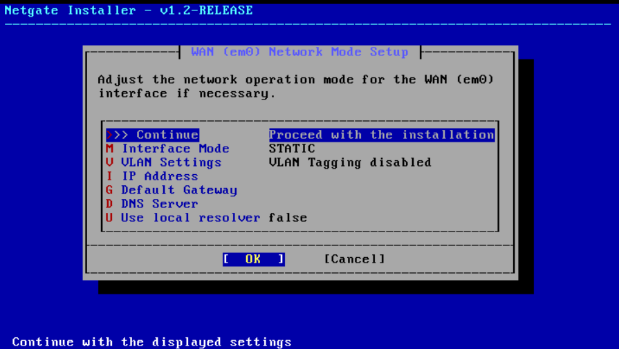
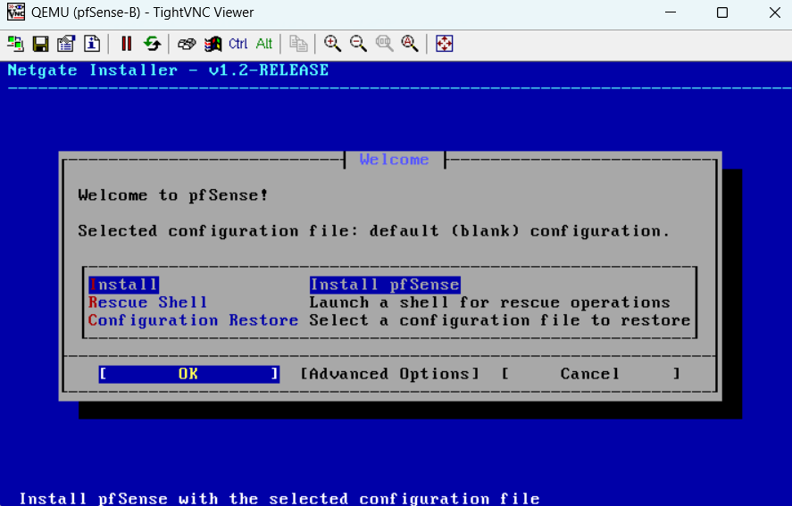
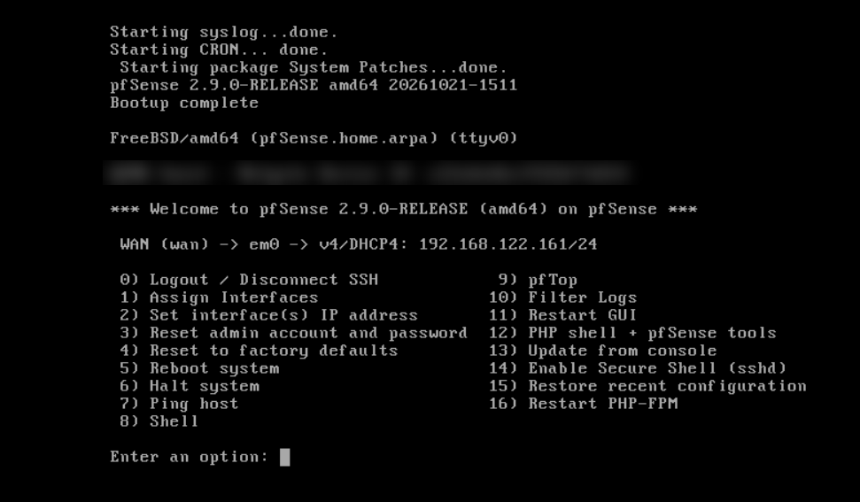

# 00 — Installer pfSense CE 2.9 dans GNS3

Installation de pfSense CE 2.9.0 dans GNS3 avec l'installateur Netgate v1.2, jusqu'à un firewall dont le WAN sort sur Internet et le LAN est adressé.

## Prérequis et topologie

| Élément | Valeur |
|---------|--------|
| Environnement | GNS3 + GNS3 VM (VMware Workstation) |
| Installateur | Netgate Installer v1.2-RELEASE, édition CE |
| Ressources du nœud | 1 vCPU, 2 Go de RAM, console VNC |
| WAN (em0) | DHCP pendant l'installation, puis statique 192.168.122.x/24, passerelle 192.168.122.1 |
| LAN (em1) | 192.168.1.1/24 (site A) ou 10.10.10.1/24 (site B), sans serveur DHCP |

```
NAT GNS3 (192.168.122.1) ─ Switch-WAN ─ em0 / WAN  [pfSense]  em1 / LAN ─ Switch-LAN ─ postes
```

> L'installateur récupère pfSense **en ligne** : le WAN doit être relié au NAT avant de lancer l'installation.

## Étapes

### 1. Télécharger l'installateur
- [pfsense.org/download](https://www.pfsense.org/download/) renvoie vers la boutique Netgate (gratuit, mais compte et panier à 0 requis).
- Produit **Netgate Installer**, image **AMD64 ISO** (adaptée aux VM).
- Vérifier l'empreinte SHA-256 **sur le fichier compressé**, puis décompresser :
  ```powershell
  Get-FileHash .\netgate-installer-amd64.iso.gz -Algorithm SHA256
  ```

### 2. Template GNS3 et câblage
- Template QEMU : image d'installation + disque vide, 1 vCPU, 2048 Mo, console VNC.
- Câbler **avant** le premier démarrage : **Ethernet0 = em0 (WAN) → Switch-WAN**, **Ethernet1 = em1 (LAN) → Switch-LAN**.

### 3. Installation
L'installateur configure d'abord le WAN pour télécharger pfSense.



Ici, le WAN est en STATIC **sans adresse** : rien ne peut être téléchargé. Passer en **DHCP** (touche M) ; si aucune adresse n'apparaît, vérifier le câble Ethernet0 → Switch-WAN. Choisir ensuite l'édition **CE** et le disque vide.

### 4. Retirer le support d'installation



Retour sur l'installateur après redémarrage : l'image d'installation est encore attachée. Arrêter le nœud, la retirer du **nœud** (onglet CD/DVD ou HDD) ou mettre **Boot priority = HDD**. Ne jamais modifier le template, qui doit garder l'installateur.

### 5. Assigner les interfaces et fixer les adresses



Seul le WAN est configuré au premier démarrage.
- **Option 1** : `em0` = WAN, `em1` = LAN.
- **Option 2** : WAN en statique (IP, masque 24, passerelle 192.168.122.1), LAN avec son adresse, sans DHCP.
- **Vérification** : l'en-tête affiche WAN et LAN ; l'option 7 (ping 8.8.8.8) répond.

## Pièges rencontrés

| Symptôme | Cause | Correction |
|----------|-------|------------|
| WAN en STATIC sans adresse dans l'installateur | Pas de réponse DHCP | Mode DHCP ; vérifier Ethernet0 → Switch-WAN |
| Retour sur l'écran Welcome | Image d'installation encore attachée | La retirer du nœud ou Boot priority = HDD |
| Pas de ligne LAN | L'installateur ne configure que le WAN | Option 1 de la console |
| Console qui semble figée | Démarrage ou téléchargement en cours | Patienter ; vérifier le type de console (VNC/telnet) |
