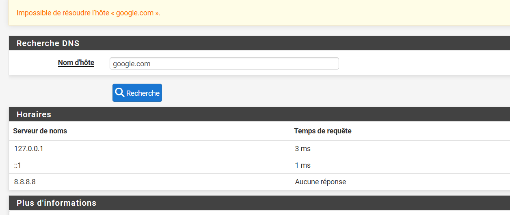
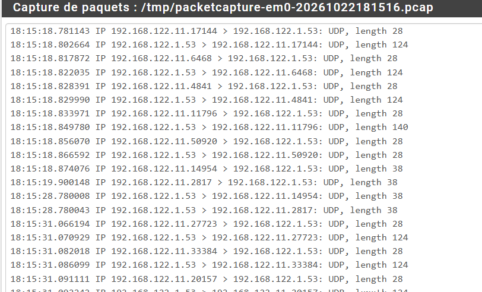
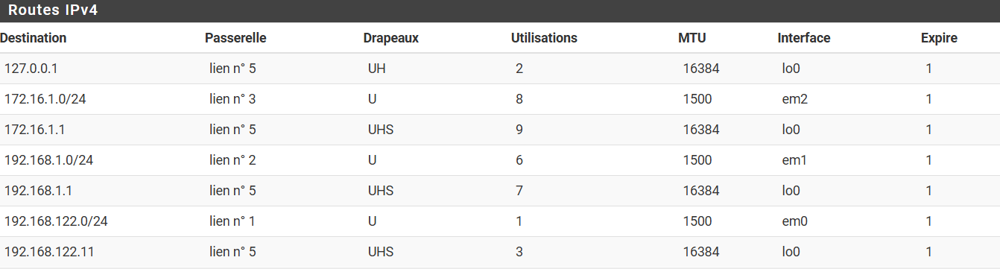
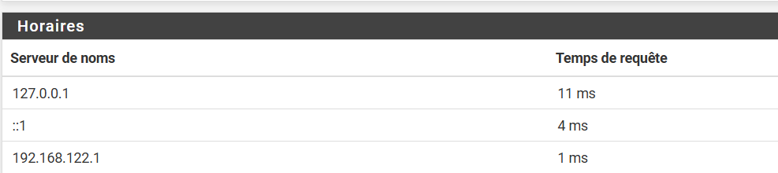

# Lab 04 — VPN IPsec site-à-site (pfSense ↔ pfSense)

Tunnel **IKEv2** entre deux sites, chiffrement prouvé par capture, puis trois pannes provoquées et diagnostiquées dans les logs.

📄 Fiche complète : [docs/Lab_Securite_4_IPsec_pfSense.pdf](docs/Lab_Securite_4_IPsec_pfSense.pdf)

## Pourquoi pas pfSense ↔ FortiGate ?
Relevé sur la FortiGate en licence d'essai : phase 1 en **DES uniquement**. pfSense 2.9 ne propose plus DES (algorithmes obsolètes retirés). Aucune proposition commune → tunnel impossible. Règle d'or d'IPsec : les deux pairs doivent partager au moins une proposition.

## Topologie
```
            Switch-WAN (192.168.122.0/24, NAT .1)
           /                                    \
pfSense-A WAN = 192.168.122.11          pfSense-B WAN = 192.168.122.12
pfSense-A LAN = 192.168.1.1/24          pfSense-B LAN = 10.10.10.1/24
            ===== Tunnel IPsec 192.168.1.0/24 <-> 10.10.10.0/24 =====
```

## Paramètres (effet miroir)

| Paramètre | pfSense-A | pfSense-B |
|-----------|-----------|-----------|
| Pair distant | 192.168.122.12 | 192.168.122.11 |
| IKE / authentification | IKEv2, PSK mutuelle (identique) | idem |
| Phase 1 | AES-256 / SHA-256 / DH 14 / 28 800 s | idem |
| Réseau local (P2) | 192.168.1.0/24 | 10.10.10.0/24 |
| Réseau distant (P2) | 10.10.10.0/24 | 192.168.1.0/24 |
| Phase 2 | ESP AES-256 / SHA-256 / PFS 14 / 3 600 s | idem |
| Règle onglet IPsec | 10.10.10.0/24 → LAN subnet | 192.168.1.0/24 → LAN subnet |

## Preuves
- **Status → IPsec** : phase 1 *Established*, Child SA avec deux SPI (une SA par sens).
- Pings dans les deux sens entre les LAN.
- Capture **LAN** : ICMP en clair. Capture **WAN** : uniquement de l'**ESP** entre .11 et .12.

## Dépannage : trois pannes provoquées

| Panne | Statut | Logs |
|-------|--------|------|
| PSK différente | Phase 1 non établie | `AUTHENTICATION_FAILED` (initiateur), `MAC mismatched` (répondeur) |
| Hachage phase 2 différent | Phase 1 OK, aucune Child SA | `NO_PROPOSAL_CHOSEN`, `no acceptable proposal` |
| Réseau distant erroné | Phase 1 OK, aucune Child SA | `TS_UNACCEPTABLE` |

**Méthode** : identifier la phase qui échoue → lire les logs **des deux côtés** → comparer `received proposals` et `configured proposals` élément par élément.

## Pièges rencontrés en préparant le site B (passage du WAN en statique)
Passer une interface de DHCP en statique fait perdre **la passerelle par défaut et le DNS** fournis par le DHCP.

| Symptôme | Capture | Correction |
|----------|---------|------------|
| 8.8.8.8 ne répond pas en DNS |  | DNS = 192.168.122.1 (DNS du NAT GNS3) |
| Requêtes et réponses visibles sur le WAN, mais résolution en échec |  | Résolveur : mode transfert, **DNSSEC désactivé** |
| Pas de route par défaut |  | Définir la passerelle par défaut (System → Routing) |
| Résolution OK |  | — |

## Parallèle FortiGate
FortiGate est **route-based** par défaut : la phase 1 crée une interface de tunnel ; il faut une route statique vers le réseau distant et deux politiques (LAN → tunnel, tunnel → LAN). Diagnostic : `diagnose debug application ike -1`.
